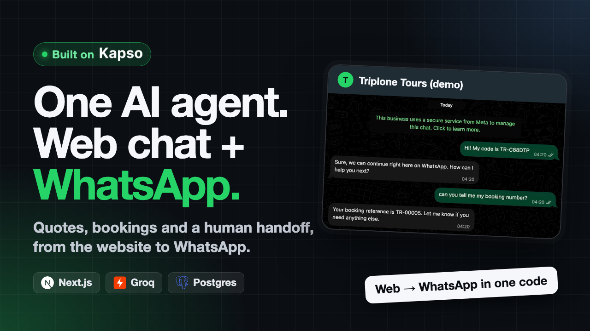

# Front Desk



One AI agent that answers a tour agency's customers on web chat and WhatsApp, built on [Kapso](https://kapso.ai).
A person can take over any conversation from Kapso's inbox, and hand it back when they're done.

The business is Triplone Tours, a small-group tour agency in Dhaka, Bangladesh, with prices in BDT.
Nothing here takes real bookings or payments.

Live demo: [frontdesk.jubayeramb.com](https://frontdesk.jubayeramb.com).
The [how it works](https://frontdesk.jubayeramb.com/how-it-works) page explains the design and what tripped me up on Kapso.

<p align="center">
  
</p>

## What it does

- **Quotes and books.** A customer asks for a price, picks a departure and gets a booking reference like `TR-00012`.
  Prices and departures come from Postgres through tools, and the totals are computed in code.
- **One agent, two channels.** The agent returns plain replies and choices.
  The web adapter renders buttons and markdown.
  The WhatsApp adapter turns the same replies into reply buttons, lists or numbered text.
- **Web to WhatsApp.** A visitor can carry a web conversation over to WhatsApp with a short code in a prefilled message.
- **Handoff.** Staff use Kapso's inbox, embedded at `/staff`.
  A reply from the inbox takes the conversation over, and the agent stays quiet until someone hands it back.
- **Webhooks done carefully.** Signatures are verified on the raw body, each event is stored once, and each customer's events are processed in order after the 200.
  Failed events are retried, and a retry never sends a second reply.
- **The 24-hour window.** WhatsApp replies only go out within 24 hours of the customer's last message.
  A late reply is stored as blocked, and the customer's page and `/staff` show the time left.
- **Guards.** Per-contact and daily limits keep the demo inside Groq's free tier.
  A price guard replaces any reply that states an amount no tool returned.

## What it doesn't do

- No payments, cancellations, seat capacity or discounts.
  A booking is a reference number and nothing more.
- No template messages, so nobody can message a customer after the 24-hour window closes.
- One shared staff password, with no per-staff accounts or assignment.
- No streaming. Replies arrive whole.

## Stack

Next.js 16 on Vercel, Postgres on Neon with Drizzle, the AI SDK with `gpt-oss-120b` on Groq (falling back to `gpt-oss-20b`), and Kapso for WhatsApp through `@kapso/whatsapp-cloud-api`.
Tests use Vitest and Playwright.

## Run it locally

You need Node 24, pnpm, and Docker for the test database.

```sh
pnpm install
cp .env.example .env.local
```

Fill in `.env.local`.
The app checks every variable at startup, so each one not marked optional needs a value.
Generate the secrets with `openssl rand -hex 32`.
For the web chat alone, the Kapso values can be placeholders in the right format, like `KAPSO_PHONE_NUMBER_ID=1`.

```sh
pnpm db:migrate && pnpm db:seed
pnpm dev
```

Then open http://localhost:3000 and use the chat.

To test:

```sh
pnpm test                          # unit tests
pnpm db:test:up && pnpm test:int   # integration tests against a docker Postgres
pnpm test:e2e                      # Playwright, with a scripted fake model
```

`AGENTS.md` has every command, the environment variables, WhatsApp through a Cloudflare tunnel, and the architecture rules.
The `openspec/` folder holds the design and specs for each change.

## Trying it on WhatsApp

WhatsApp runs on Kapso's sandbox number, which only answers phones registered for it in the Kapso dashboard.
Email [jubayeramb@gmail.com](mailto:jubayeramb@gmail.com) and I'll add yours.
The web chat works for everyone.

## What's next

1. A template message so staff can reach a customer after the window closes.
2. Per-staff accounts in `/staff`, with the conversation assigned to whoever replied.
3. Buffering on the webhook, once turning it on for an existing webhook takes effect.
